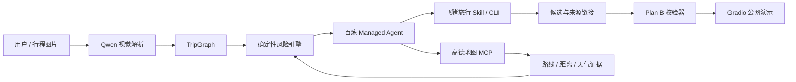

---
# ModelScope Studio card metadata
domain: multi-modal
tags:
- Agent
- AI旅行
- 百炼
- 飞猪旅行
- 高德地图MCP
- Gradio
- TripGraph
datasets:
  evaluation:
  test:
  train:
models:
license: MIT License
---

# TripTwin 旅行数字孪生守护者

TripTwin 将零散行程解析为结构化 `TripGraph`，使用确定性规则发现时间、日期、预算、体力和天气风险，再基于飞猪旅行真实候选生成可验证的 Plan B。它只做风险提示与候选推荐，**不会自动预订或支付**。

> 当前状态：Stage 1–6 已完成；[GitHub 公共仓库](https://github.com/amazingLH/triptwin-travel-guardian)已发布，ModelScope 公网 Demo 正在部署。

## 作品亮点

- **旅行数字孪生**：把车次、酒店、景点、同行人和约束统一为可计算的 TripGraph。
- **确定性风险引擎**：风险结论来自显式规则和证据，不让模型自由编造。
- **真实工具闭环**：百炼 Managed Agent 调用飞猪旅行 Skill/CLI 与高德地图 MCP。
- **受约束的 Plan B**：保护已订车次与酒店，限制增量成本，并保留候选来源链接。
- **主动巡检**：Managed Agent Deployment 可按同一基线重复运行并生成审计记录。
- **隐私与可追溯**：密钥不入库；原始上传图片不进入浏览器历史；页面明确数据时效和未核验范围。

## 架构



LLM 负责理解、编排和解释；TripGraph、风险规则、候选校验与证据文件负责约束结果。

## 已验证结果

- 图片解析：47 个黄金字段，准确率 97.9%，低置信字段 0。
- 黄金案例：检出 5 个风险 / 335 分；验证后的 Plan B 未覆盖风险为 0。
- FlyAI：累计 7 条有效真实查询证据，命令均为 `exit_code=0`、业务 `status=0`。
- 高德 MCP：路线、距离、天气及 POI 搜索均已真实调用；未覆盖行程日期的天气不会被猜测。
- Deployment：首次手动巡检以 `end_turn` 正常结束，结构化记录见 `docs/evidence/stage6-deployment/run.json`。
- 自动化测试：运行 `pytest` 查看当前准确数量。

## 本地运行

要求 Python 3.11+。

```powershell
python -m venv .venv
.\.venv\Scripts\Activate.ps1
pip install -r requirements.txt
Copy-Item .env.example .env
```

在 `.env` 中配置自己的凭据：

```text
DASHSCOPE_API_KEY=
FLYAI_API_KEY=
BAILIAN_WORKSPACE_ID=
BAILIAN_AGENT_ID=
BAILIAN_ENVIRONMENT_ID=
DASHSCOPE_TEXT_MODEL=qwen3.7-flash
DASHSCOPE_VISION_MODEL=qwen3.7-flash
```

公开演示默认启用每日额度保护：每个浏览器最多 3 次自由问答和 1 次自行上传
图片解析，全站最多 25 次自由问答和 5 次图片解析。重复问题使用浏览器缓存，
不重复调用模型；模型调用事件不暴露具名公开 API。额度可通过以下普通环境变量调整：

```text
TRIPTWIN_BROWSER_QUESTION_LIMIT=3
TRIPTWIN_BROWSER_IMAGE_LIMIT=1
TRIPTWIN_GLOBAL_QUESTION_LIMIT=25
TRIPTWIN_GLOBAL_IMAGE_LIMIT=5
```

然后启动：

```powershell
python app.py
```

默认监听 `0.0.0.0:7860`，本机访问 `http://127.0.0.1:7860/`。

## 测试

```powershell
python -m pytest -q
```

测试覆盖 TripGraph 校验、风险规则、候选约束、百炼事件解析、密钥脱敏、动态问答、会话隔离、高德证据与 Deployment 展示。

## ModelScope Studio 部署

本项目使用 Gradio，根目录包含 `app.py`、`requirements.txt` 和 `ms_deploy.json`。在创空间的 **Secret/密钥** 配置中添加以下名称，不要把真实值写入代码或普通公开变量：

```text
DASHSCOPE_API_KEY
FLYAI_API_KEY
BAILIAN_WORKSPACE_ID
BAILIAN_AGENT_ID
BAILIAN_ENVIRONMENT_ID
```

模型名称不是密钥，可按需在普通环境变量中覆盖；未配置时默认使用
`qwen3.7-flash`：

```text
DASHSCOPE_TEXT_MODEL=qwen3.7-flash
DASHSCOPE_VISION_MODEL=qwen3.7-flash
```

部署完成后必须使用无痕窗口和手机网络分别测试，并确认运行日志不包含凭据。

## 数据与能力边界

- 候选价格、库存、天气和交通结果都有时效性，页面展示的是对应获取时间的证据。
- 高德地理编码可能返回行政区级结果；精度不足时会明确告警，不冒充精确 POI。
- 浏览器历史仅保存在当前浏览器，最多 20 个会话；云端重启不会提供跨设备账户历史。
- 公开站点中的自由问答和用户自传图片解析会使用部署者配置的百炼额度；合成示例、确定性风险检查、Plan B、缓存巡检和会话管理不调用模型。
- 作品不执行预订、支付、退改或订单操作。
- `examples/` 与演示图片均为合成数据，不包含真实个人信息。

## 目录

```text
app.py                      Gradio 入口
src/triptwin/               TripGraph、风险、Agent 与展示服务
tests/                      自动化测试
examples/                   合成黄金行程
assets/                     合成演示图片
docs/evidence/              脱敏的真实调用证据
docs/stage6-validation-report.md
```

## AI 协作说明

本项目在代码实现、测试、文档与排错过程中使用了 AI 编程助手；产品定义、平台账号操作、真实工具授权、运行确认和最终提交由参赛者完成。所有外部工具结果均通过控制台事件或脱敏证据复核。

## License

项目原创代码采用 [MIT License](LICENSE)。`skills/triptwin-flyai/` 保留其原始 MIT 许可证与版权声明。

